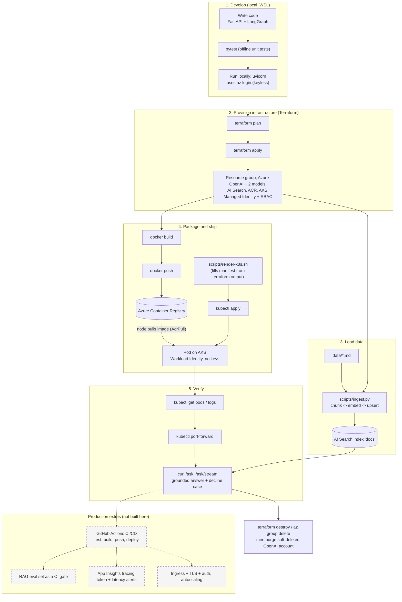
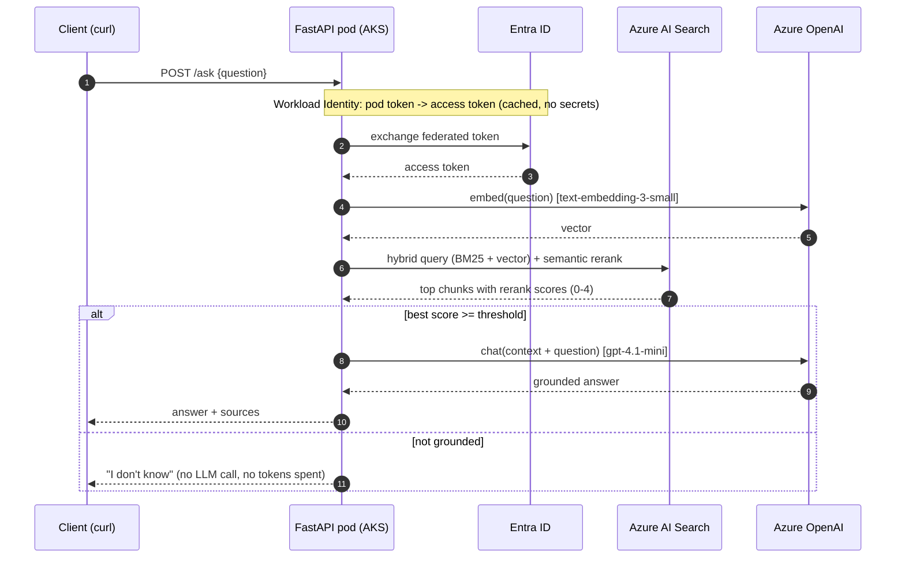
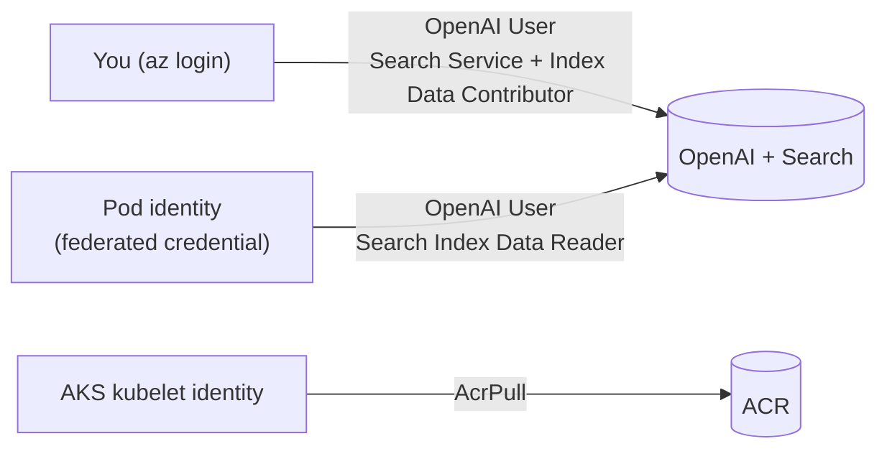

# How this demo gets built, tested and deployed

Solid boxes = what we actually did. Dashed boxes = what a production team adds (CI/CD, evals, monitoring).

## 1. Build -> test -> deploy

## 2. What happens on one request (runtime)

## 3. Who can do what (identity map)

## Cheat sheet: where each step lives
| Step | File / command |
| --- | --- |
| Infra | `infra/` -> `terraform apply` |
| Data | `scripts/ingest.py` (re-run when documents change) |
| Image | `Dockerfile` -> `docker build` / `push` |
| Deploy | `k8s/deployment.yaml` (template) + `scripts/render-k8s.sh` |
| Test | `pytest`, then `kubectl port-forward` + `curl` |
| Teardown | `terraform destroy`, purge soft-deleted OpenAI |
